# בדיקת מקצה לקצה 2026-11-25: לוח חדש לגמרי, דפדפן אמיתי (ענן, Linux)

| | |
|---|---|
| גרסה | `main` ב-`66762c0` (כולל `45aa22c` וכל תיקוני ה-E2E) |
| סביבה | מכונת ענן Linux, השרת `pcb.py serve`, דפדפן Chromium דרך Playwright, 1440×900 |
| מנוע | Claude Code CLI (sonnet), מחובר |
| רשת | JLC, LCSC, jlcdfm ו-EasyEDA פתוחים (סביבה `pcb-advisor`) |
| **מה לא נבדק** | **Altium**: אין מחשב Windows מחובר לסשן, ולכן אין computer use. שרטוט, Place/Route ב-Altium, DRC, OutJob ו-Gerber לא הורצו. |

## הלוח

פרויקט חדש בשם **Climate logger**, שנוצר בכפתור New project. הלוח הוא 40×30 מ"מ עם:
- כניסת USB-C של 5 V
- וסת AMS1117-3.3
- חיישן SHT31 על I2C
- מחבר I2C של 4 פינים
- נגדי pull-up
- LED ירוק
- 4 חורי M3

כל שלב בוצע כמו שמשתמש היה מבצע אותו: כתיבה בצ'אט, לחיצות על Save, Confirm, Approve, Check stock, Check datasheets ו-Export.

השלבים ש-Altium מבצע בדרך כלל (Place ו-Route) הורצו בלי Altium. השתמשתי באותו קוד Python שהגשר קורא לו (`bridge._netlist_parts`, `_mechanical_parts`, `layout.plan_placement`, `route.plan_routes`), עם ה-footprints שהספרייה בנתה מ-EasyEDA.

## תוצאה בקצרה

**המערכת עובדת מקצה לקצה עד Altium, בלי שגיאות JavaScript ובלי חריגות בשרת.** נמצאו שתי בעיות דיוק חשובות, ששתיהן היו עוברות בשקט ללוח, ועוד כמה בעיות ממשק קטנות. המסקנה: **לא מוכן עדיין למשתמש שעובד לבד**, עד שיתוקנו A1 ו-A2 ועד שיורץ מסלול ה-Altium על Windows.

| שלב | תוצאה |
|---|---|
| פרויקט חדש | עובד (תמונה 1) |
| Idea: טיוטה מהצ'אט, דיאגרמת בלוקים, Save, Confirm | עובד, עם בעיה A3 (תמונות 2–3) |
| BOM: בחירה ב-JLC, מלאי ומחיר חיים, Approve, Check stock | עובד, עם בעיה A4 (תמונות 4–5) |
| ייצוא BOM ל-JLC | **נכון**: יש מספר LCSC בכל שורה וכל ה-designators (R1/R2, R3/R4, C1/C2) |
| Build library / Create Altium project | הודעה ברורה שצריך Windows ו-Altium (תמונה 6) |
| ספריית חלקים (EasyEDA) | 8 תקינים ו-2 אזהרות כנות (גוף התלת-ממד של מחבר מוזז מה-pads) |
| Schematic: netlist, תצוגה מקדימה, אישור כרטיסים | עובד, עם בעיה A2 (תמונות 7–8) |
| DFM: בדיקת פינים מול דפי נתונים | SHT31 אומת אוטומטית; ל-AMS1117 אין טבלת פינים בדף הנתונים (תמונה 10) |
| Outputs: שער החסימה | מציג נכון את החסימה ואת האזהרה (תמונה 9) |
| Place ו-Route (קוד המוצר, בלי Altium) | 8/8 נטים מנותבים, 0 כשלונות, GND יורד ל-pour, המחברים צמודים לקצוות ופונים החוצה. בעיה A1 (תמונה 11) |
| חיפוש Ctrl+K | עובד (תמונה 12) |
| רוחב 1024 | עובד |
| רוחב טלפון (390) | בעיה U7 (תמונה 13) |

## בעיות דיוק (משפיעות על הלוח)

**A1. קבלי הצימוד הוחלפו, בלי שום אזהרה. (חמור)**
- **מה קרה:** C3 (100 nF) נועד לצימוד של ה-SHT31, אבל הוא מונח 2.8 מ"מ מיציאת הווסת ו-**14.4 מ"מ** מה-VDD של ה-SHT31. C2 (10 µF) הוא קבל היציאה של הווסת, והוא מונח ליד ה-SHT31, **17.8 מ"מ** מיציאת הווסת.
- **למה לא הייתה אזהרה:** `decap_distance_warnings` ו-`findings` ריקים. הכלל "קבל כלשהו על אותו פס בטווח 3 מ"מ מכל פין אספקה" מתקיים טכנית.
- **הסיבה:** ה-placer מסדר את הקבלים מהקטן לגדול ונותן לכל אחד את פין האספקה הקרוב ביותר, ויציאת הווסת נחשבת לפין אספקה.
- **ההשלכה:** קבל היציאה של AMS1117 חייב להיות צמוד לווסת בשביל יציבות, וה-100 nF צריך להיות צמוד ל-SHT31.
- **הצעה:** קודם לשבץ קבלים קטנים ליד פיני VDD של רכיבים שאינם וסתים, ואחר כך קבלי bulk ליד הווסת. להתריע כשקבל היציאה של וסת רחוק ממנו. קבל שתפקיד שורת ה-BOM שלו נקרא "X decoupling" צריך ללכת ליד X.

**A2. אי-התאמה בין ה-netlist ל-footprint לא מתגלה אוטומטית אחרי בניית הספרייה. (חמור)**

ה-netlist נכתב לפני שהספרייה נבנתה. אחרי הבנייה, ה-footprints כללו pads שלא היו ב-netlist:
- **USB-C (J1):** ה-pad השני של VBUS ‏(B4A9) וה-pad השני של GND ‏(B1A12) לא היו מחוברים. ארבעת pads המעטפת נקראים `1`–`4`, בעוד שב-netlist הם הופיעו כ-`S1`, שלא קיים ב-footprint.
- **וסת (U1):** ה-tab ‏(pad 4, VOUT) לא היה מחובר.
- **SHT31 (U2):** ה-EP ‏(pad 9) לא היה מחובר.

האפליקציה לא הציגה את זה בשום מקום: לא ב-BOM, לא ב-Schematic ולא ב-DFM. כששאלתי בצ'אט "Review this sheet against the built library", הסוכן מצא את כל הבעיות ותיקן אותן אחרי אישור (תמונה 8).

לא ברור אם השרטוט ב-Altium היה תופס את זה (`pins.unmapped`). בלי שאלה יזומה, הלוח היה יוצא עם חצי מחיבורי ה-VBUS וה-GND ועם מעטפת צפה.

**הצעה:** להריץ את השוואת ה-pads ל-pins (`pin_model._check_part` לכיוון ההפוך) מיד אחרי Build library, ולהציג את התוצאה כחסימה בעמוד ה-Schematic.

**A3. דרישה נדרסה ב-Idea. (בינוני)**
- **מה קרה:** הסוכן הציע שתי דרישות תחת אותו נושא, "Power". השנייה (הווסת) החליפה את הראשונה: "USB-C 5 V only, 5.1k pull-downs on CC1 and CC2".
- **איפה נשאר זכר:** הדרישה הראשונה נשארה רק ב-`prev_text` ב-`idea.json`, ואחרי Save היא כבר לא מוצגת.
- **מה הציל את המצב:** הסוכן זכר את הנגדים בכל זאת.
- **הצעה:** שתי הצעות עם אותו נושא באותו תור צריכות להתמזג או לקבל נושאים נפרדים, לא לדרוס זו את זו.

**A4. שורות BOM עם ref אחד במקום שניים. (נמוך)**
- **מה קרה:** הנגדים "CC1/CC2 pull-downs" קיבלו רק R1, הנגדים "SDA/SCL pull-ups" קיבלו רק R3, והקבלים "LDO input/output caps" קיבלו רק C1.
- **מה תיקן:** הסוכן תפס את זה בעצמו בשלב ה-Schematic והציע את R2, R4 ו-C2.
- **הצעה:** בדיקה בשרת, כשתיאור התפקיד מונה שני דברים ("X/Y", "input/output") ויש ref אחד.

**A5. פינים שלא אומתו.** U1 (בדף הנתונים יש איור ולא טבלה), J1 ו-J2 (אין דף נתונים) ו-D1 נשארו "לא מאומתים". המוצר מציג את זה כאזהרה בעמודי Outputs ו-DFM, כמו שתוכנן.

## בעיות ממשק

- **U1. הודעה שחוסמת כפתורים.** ההודעה השחורה "This project is not linked to an Altium project" חוזרת בכל טעינת עמוד ומכסה את כפתורי הפעולה בפינה הימנית העליונה ("Next: …").
- **U2. תצוגה שלא מתרעננת.** אחרי אישור כרטיסי BOM בצ'אט, תצוגת ה-Schematic עדיין מציגה את R2, C2 ו-R4 כ-"pending approval" עד רענון ידני.
- **U3. חסימה מוצגת מוקדם מדי.** בפרויקט חדש לגמרי יש נקודה אדומה עם "1" על Outputs, ובעמוד Schematic מופיע הפס "the board was never checked… press Route board" לפני שיש בכלל לוח.
- **U4. הצעת צעד ישנה.** אחרי אישור הרעיון, ההצעה בצ'אט נשארת "Help me with the next step: Idea".
- **U5. ספירה שגויה.** הסוכן כתב "I picked all 11 lines" אבל הציע 10.
- **U6. טקסט שגולש.** טקסט ההערות בתחתית מסגרות ה-Schematic גולש מעבר למסגרת ונחתך ("…Expos").
- **U7. רוחב טלפון.** עמודת Part מתכווצת ל-"P" בלי שמות, ועמודת Status נחתכת.
- **U8. עמודת LCSC ריקה בכרטיסים.** בכרטיסי ההצעה עמודת LCSC מציגה "·", אף שמספר ה-LCSC ידוע (בייצוא הוא כן מופיע).
- **U10. קובץ שנוצר לפני בדיקת Windows.** על Linux, הכפתור Create an Altium project יוצר קובץ `.PrjPcb` בתיקייה יחסית בשם `C:\Users\Public/Documents/Altium/...` בתיקייה שהשרת רץ ממנה, ורק אחרי זה מסרב עם "Windows only". הסיבה: `bridge.py:415` מחזיר את הנתיב `C:\Users\Public` כשאין משתנה `PUBLIC`. צריך לבדוק את מערכת ההפעלה לפני שכותבים קבצים.
- **U9. דף נתונים שלא מקושר.** U2 הופיע כ-"no datasheet linked" אף שדף הנתונים כבר הורד ונמצא ב-Sources. הוא קושר רק אחרי לחיצה על Check datasheets.

## מה עבד טוב

- **הצ'אט:** הוא מסביר כל הנחה ("(assumed)"), מצטט עמודים בדפי הנתונים, ומתקן את עצמו בבלוק "After the results".
- **BOM:** מחירים ומלאי חיים מ-JLC, עמלות Extended ($12.28), וייצוא JLC תקין.
- **ספריית החלקים:** נבנתה אוטומטית מ-EasyEDA, עם אזהרות כנות על מודלי תלת-ממד מוזזים.
- **סקירה לבקשה:** הסוכן מצא כל pad לא מחובר וכל פין חסר כשביקשו ממנו.
- **Place ו-Route:**
  - המחברים צמודים לקצוות ופונים החוצה. ה-USB-C בתחתית וגוף ה-header הזוויתי למעלה, כמו בדרישה "header בצד הנגדי".
  - 4 חורים בפינות.
  - 8/8 נטים ו-0 כשלונות.
  - GND יורד ל-pour ב-vias, בלי מסלולים משלו בשכבה התחתונה.
  - ה-tab של הווסת מחובר ל-+3V3.
- **הודעות כשאין Altium:** ברורות ומסבירות מה חסר.

## להמשך

1. לתקן את A1 ואת A2: הם משנים את הלוח עצמו.
2. להריץ את אותו תרחיש על Windows עם Altium: לחבר את המחשב לסשן (Remote Control באפליקציית Claude), ואז לבדוק Draw, Place, Route, DRC, OutJob ו-Gerber עם computer use.
3. ממשק: U1 ו-U3 קודם, כי הן מבלבלות משתמש חדש כבר במסך הראשון.

## תמונות

1. פרויקט חדש נוצר
   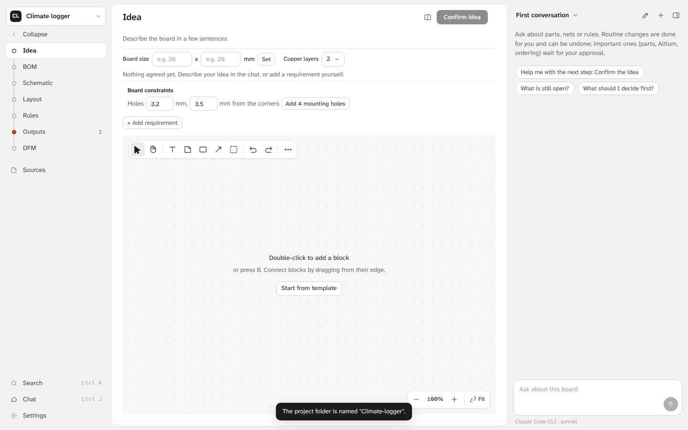
2. Idea: הסוכן ניסח דרישות ודיאגרמה
   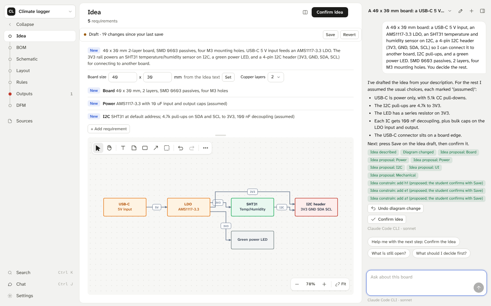
3. Idea אושר
   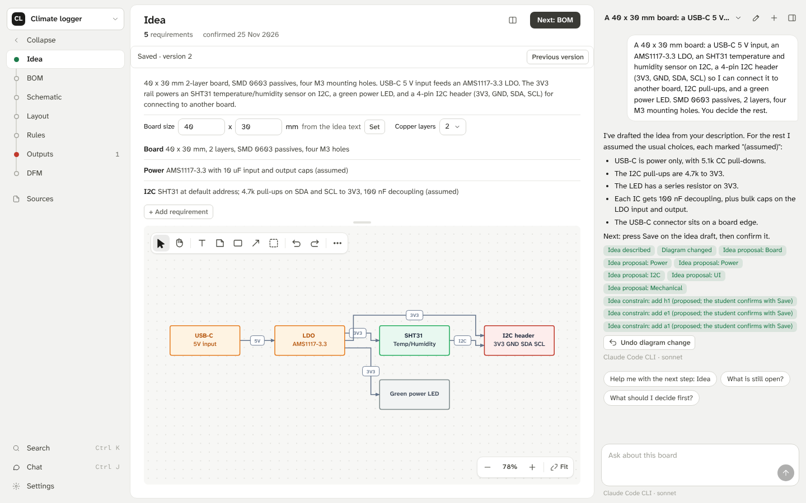
4. BOM: כרטיסי ההצעה (שימו לב לעמודת LCSC הריקה, U8)
   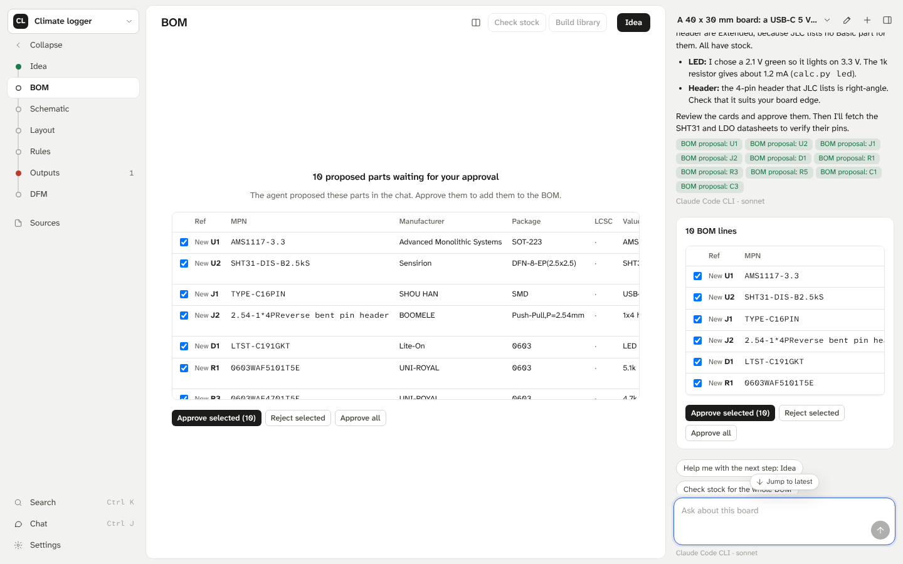
5. BOM אחרי Approve ו-Check stock
   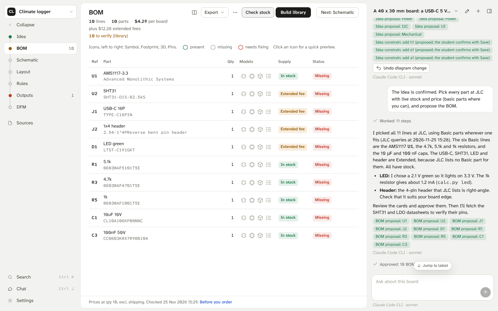
6. בלי Altium: הודעה ברורה
   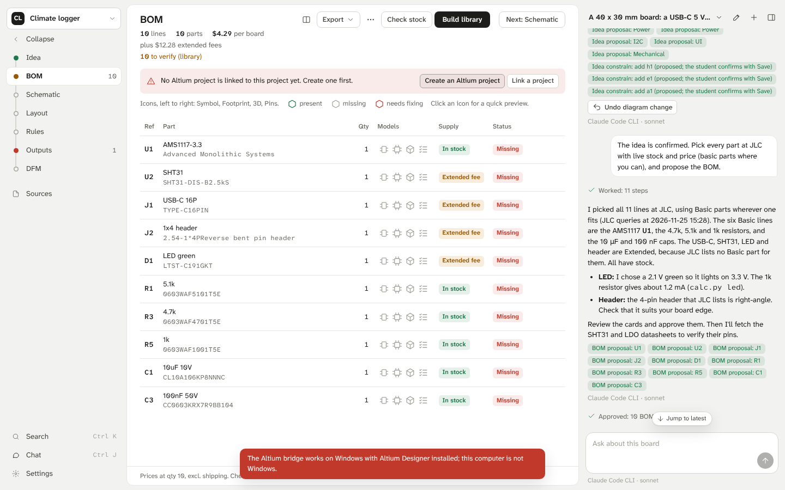
7. Schematic ראשון (R2/C2/R4 ממתינים לאישור, והפס הצהוב של U3)
   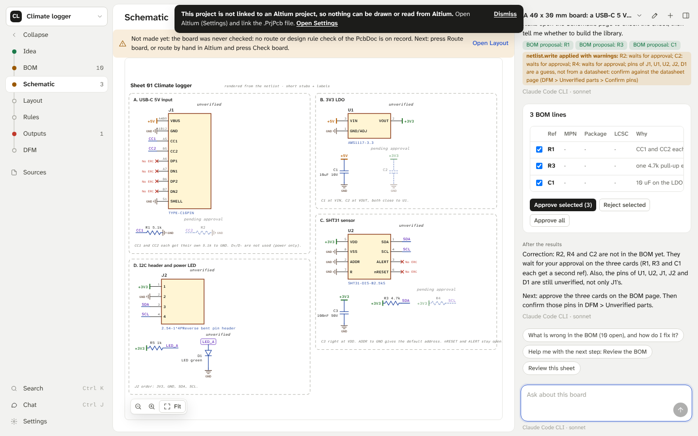
8. Schematic אחרי תיקון ה-pads (A2): כל 16 ה-pads של J1, ה-tab וה-EP מחוברים
   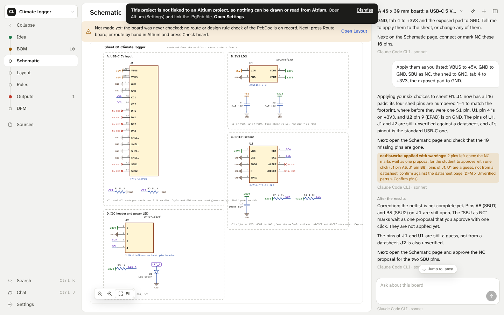
9. Outputs: השער חוסם עם הסבר
   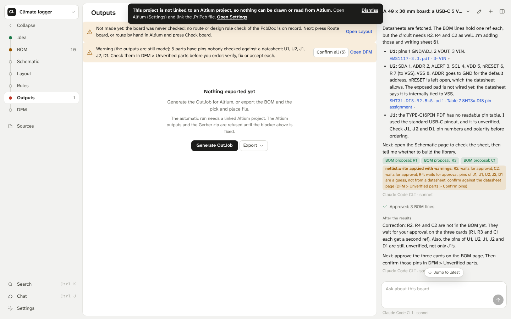
10. DFM: Check datasheets אימת את SHT31
    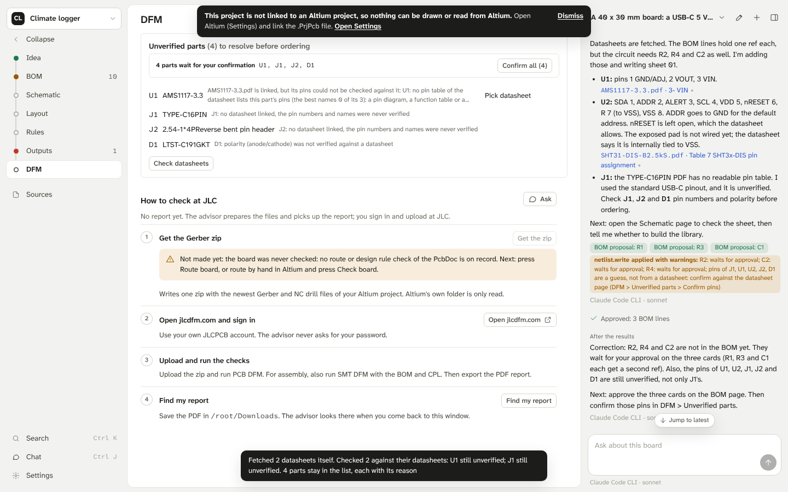
11. הלוח אחרי Place ו-Route בקוד המוצר: קבל C3 ליד הווסת וקבל C2 ליד החיישן (A1)
    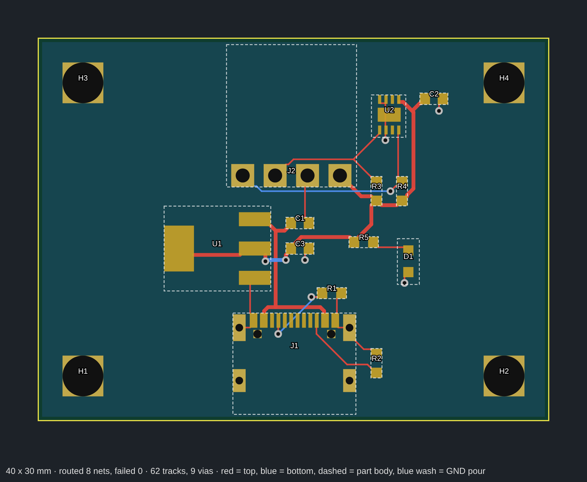
12. חיפוש Ctrl+K
    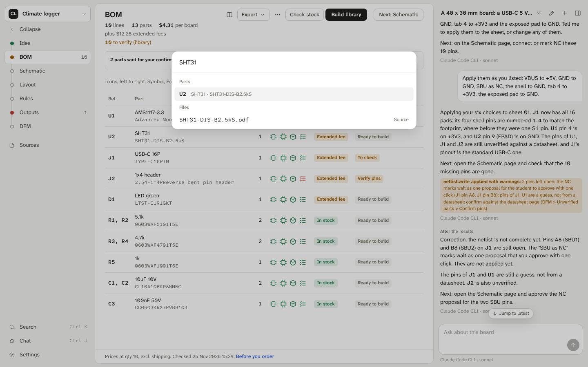
13. רוחב טלפון (U7)
    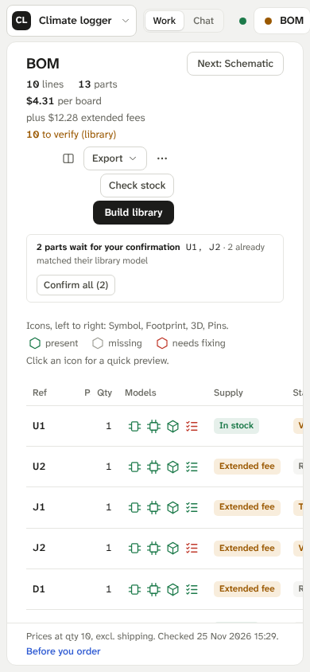
