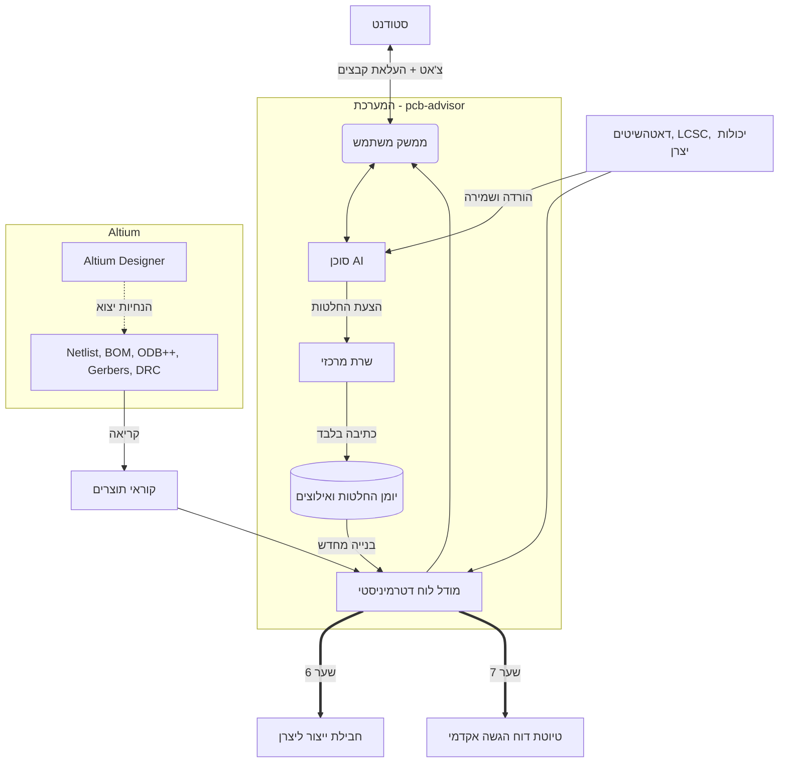

# סיכום מנהלים: ארכיטקטורת מערכת pcb-advisor

## 1. חזון המערכת ומטרה
**pcb-advisor** היא מערכת תומכת-החלטה חינוכית עבור סטודנטים לפיתוח חומרה ומעגלים מודפסים. 
המערכת **אינה** כלי אוטומטי לתכנון מעגלים ואינה עורכת קבצי CAD. במקום זאת, היא מלווה את הסטודנט משלב השרטוט ועד לשליחת קבצי הייצור, מוודאת את שלמות התכן מול דרישות העולם האמיתי (מלאי, יצרנים, דאטהשיטים), ומתעדת את כל ההחלטות.
התוצר הסופי הכפול: חבילת קבצי ייצור בדוקה, וטיוטה אוטומטית לפרקי ה"שיקולים ההנדסיים" בדוח האקדמי.

## 2. עקרונות ארכיטקטוניים מנחים (Design Principles)

1. **יומן אירועים מצטבר (Append-Only Event Sourcing):** 
   כל אינטראקציה, החלטה או אישור של הסטודנט נרשמים ליומן פעולות מרכזי (`decisions.jsonl`, `threads.jsonl`). מודל הלוח והמערכת נגזר בכל פעם דטרמיניסטית מתוך היומן. גישה זו חסינה בפני "הזיות" (Hallucinations) של ה-AI ומונעת השחתת מידע.
2. **הפרדת תפקידים – "פה, ידיים ושופט":**
   * **סוכן ה-AI ("פה וידיים"):** מוריד דאטהשיטים, בודק כללים, משווה נתונים ושואל שאלות. 
   * **הסטודנט ("שופט"):** מקבל את ההחלטות ההנדסיות ומאשר אותן.
   * **השרת (Server):** הגורם היחיד שמורשה לכתוב ליומן הנתונים ולשמור אילוצים.
3. **עבודה מול תוצרים מיוצאים (Export-Driven):**
   המערכת מנותקת מסביבת העבודה הפנימית של Altium. הסטודנט מונחה לייצא קבצים סטנדרטיים (Netlist, BOM, DRC/ERC, Gerbers, ODB++), והמערכת קוראת ומנתחת אותם. מונע תלות בגרסאות תוכנה ושבירת פורמטים בינאריים.
4. **עקיבות ואמינות מוחלטת (Provenance):**
   סוכן ה-AI לא מורשה להמציא חוקי תכן. כל בקשה או אילוץ חייבים להיות מקושרים למקור ודאי: יכולות יצרן (Fab), דאטהשיט של רכיב, חוקי הקורס, נוסחת חישוב, או תקן רשמי (כמו IPC-2221).

## 3. זרימת העבודה: מודל שבעת השערים (The 7 Gates)

תהליך התכנון מחולק ל-7 תחנות, כשהסטודנט יכול לנוע ביניהן באופן גמיש. החלטות מתחנות מוקדמות הופכות לאילוצים בתחנות מתקדמות:

* **שער 1 - הבנת המעגל:** הזנת סכמה ראשונית $\rightarrow$ גזירת דיאגרמת בלוקים ואילוצי פריסה מרכזיים.
* **שער 2 - יצרן וחוקי תכן:** בחירת יצרן (למשל JLCPCB) $\rightarrow$ נעילת Design Rules עבור ה-CAD (רוחב נתיבים, מרווחים).
* **שער 3 - רכיבים ומלאי:** טעינת ה-BOM $\rightarrow$ אימות זמינות רכיבים אצל מפיצים (DigiKey/LCSC) ומציאת חלופות קיימות.
* **שער 4 - סכמה:** טעינת Netlist ודוחות ERC $\rightarrow$ אימות חשמלי מול ה-Datasheet (כגון Pull-ups, קבלי ניתוק, פינים צפים).
* **שער 5 - פריסה (Layout):** טעינת ODB++ ו-DRC $\rightarrow$ אימות עמידה בחוקי שער 2 וזרמים (IPC), פיקוח על אסטרטגיית שכבות והארקות.
* **שער 6 - קבצי ייצור:** טעינת חבילת ה-Gerbers, קידוח ו-Pick & Place $\rightarrow$ וידוא חבילה הנדסית שלמה ומוכנה לשליחה.
* **שער 7 - דוח אקדמי:** איסוף אוטומטי של כלל יומן ההחלטות לכדי פרקי ה"שיקולי תכנון והסברים" בפורמט להגשה.

## 4. תרשים זרימת מידע

